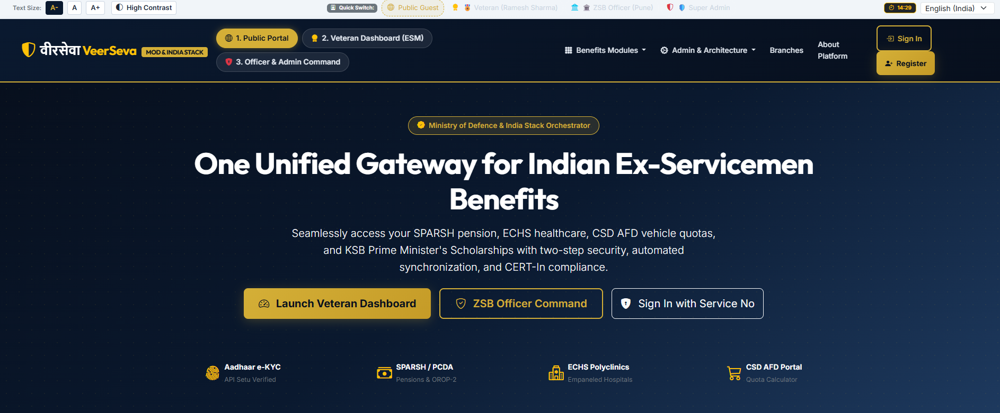
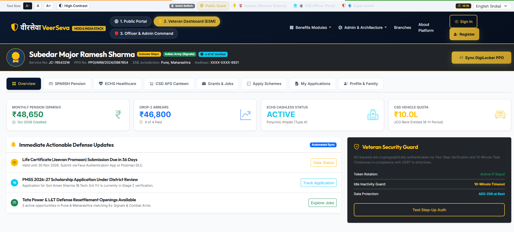
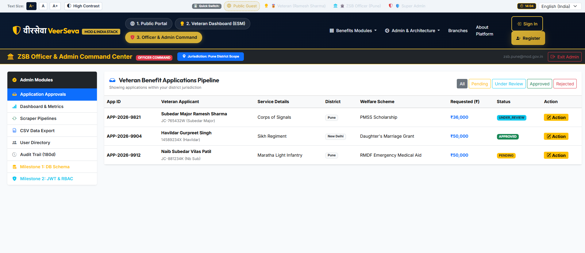

# Veer Setu: ESM Welfare Portal

A web platform for Indian Armed Forces Ex-Servicemen (ESM) and their dependents to discover welfare schemes, apply for them online and track their applications, with separate access levels for ESM users, ZSB officers and administrators.

Ex-servicemen often have to visit offices or deal with scattered paperwork to claim benefits they are entitled to. This portal brings the schemes, applications, document uploads and approval workflow into one place.

---

## Features

- **Secure login** using JWT authentication, with OTP / 2-step verification (mock OTP for demo)
- **Role-based access control (RBAC):** three roles, `ESM`, `ZSB_OFFICER` and `ADMIN`
- **ESM and dependent profiles:** manage service details and family members
- **Welfare schemes and applications:** browse schemes, apply, and track status, with input validation on all APIs
- **Secure document upload** (Multer) with authenticated download
- **Admin workflow:** review and approve applications, view statistics, export data as CSV
- **Admin-only milestone viewers:** database schema viewer (Milestone 1) and JWT/RBAC flow viewer (Milestone 2)
- **Multi-language support:** English and Hindi (i18n)
- **Accessibility features** for easier use
- **Progressive Web App (PWA):** installable, with a service worker
- **Session management** for safe login/logout handling
- **Load testing** scripts (k6 and Autocannon) with scaling notes
- **CI/CD** pipeline using GitHub Actions
- **Docker / Nginx** setup for deployment

---

## Tech Stack

| Layer | Technology |
|-------|------------|
| Frontend | HTML, CSS, JavaScript, Bootstrap 5 (PWA) |
| Backend | Node.js, Express |
| Database | MySQL (database name: `Veer_Setu`) |
| Cache | Redis |
| Auth | JWT, RBAC, OTP (mock) |
| File upload | Multer |
| DevOps | Docker, Nginx, GitHub Actions |
| Testing | k6, Autocannon |

---

## Project Structure

```
esm-orchestrator-platform/
├── backend/            # Node.js server, routes, middleware
├── frontend/           # Web app (user app, admin panel, i18n, PWA)
├── docker/             # Docker / Nginx configuration
├── load-testing/       # k6 and Autocannon test scripts
├── .github/workflows/  # CI/CD pipeline
└── README.md
```

---

## Getting Started

### Prerequisites

- [Node.js](https://nodejs.org/) (v18 or above recommended)
- [Git](https://git-scm.com/)
- [MySQL Server](https://dev.mysql.com/downloads/mysql/) (and MySQL Workbench, optional)
- Redis (only if enabled in your `.env`)

### Installation

1. **Clone the repository**
   ```bash
   git clone https://github.com/UTSAV147-svg/esm-welfare-portal.git
   cd esm-welfare-portal
   ```

2. **Create the database**

   Open MySQL Workbench (or the MySQL command line) and run:
   ```sql
   CREATE DATABASE Veer_Setu;
   ```
   Then import the schema file from the project, if provided.

3. **Install backend dependencies**
   ```bash
   cd backend
   npm install
   ```

4. **Set up environment variables**

   Copy the example file and fill in your own values (your MySQL password, a JWT secret):
   ```bash
   copy .env.example .env      # Windows
   cp .env.example .env        # Mac / Linux
   ```

5. **Start the backend**
   ```bash
   npm start
   ```

6. **Open the frontend**

   Open `frontend/index.html` in your browser, or use the VS Code **Live Server** extension.

---

## Environment Variables

See `.env.example` for the full list. Typical values:

| Variable | Description |
|----------|-------------|
| `PORT` | Port the server runs on |
| `DB_HOST` | MySQL host (default `localhost`) |
| `DB_PORT` | MySQL port (default `3306`) |
| `DB_USER` | MySQL user (default `root`) |
| `DB_PASSWORD` | Your MySQL password |
| `DB_NAME` | Database name (`Veer_Setu`) |
| `JWT_SECRET` | Secret key used to sign tokens |

> Never commit your real `.env` file. It is already listed in `.gitignore`.

---

## Running Load Tests

```bash
cd load-testing
# k6
k6 run k6-load-test.js
# Autocannon
node autocannon-test.js
```

See `load-testing/SCALING_100K_USERS.md` for the scaling notes.

---

## Screenshots

## Screenshots

### Login Page


### Dashboard


### Admin Panel


## Demo

- **Live app:** not hosted yet
- **Demo video:** coming soon

---

## Author

**Utsav**
GitHub: [@UTSAV147-svg](https://github.com/UTSAV147-svg)

---

## License

This project was built for academic purposes.
